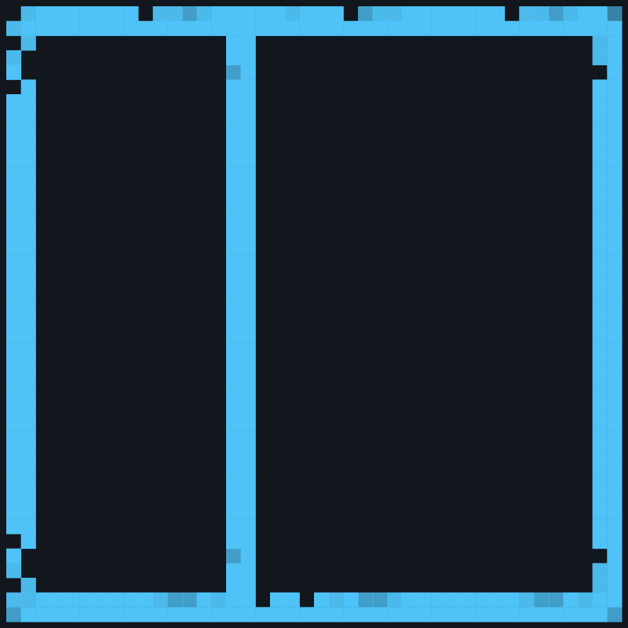
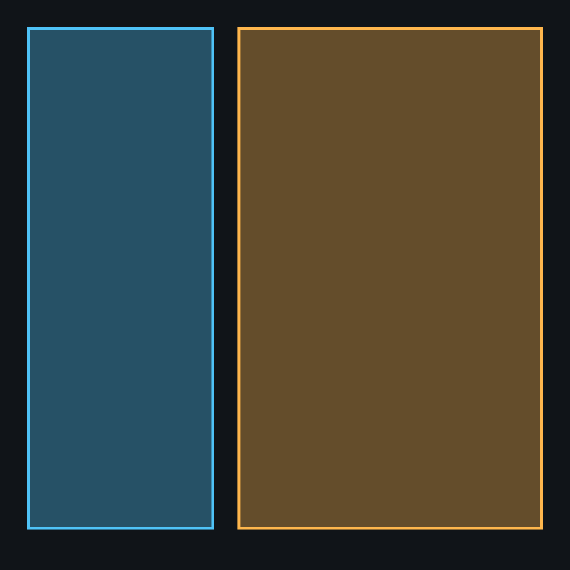

# Carty

**Carty turns a video walk-through of a real space into an accurate, high-fidelity
overhead D&D-style map — entirely on your phone.** Classical computer vision
reconstructs the map geometry from pose-stamped camera frames; an on-device LLM
(Gemma 4 E2B via LiteRT-LM) acts only as a sparse, reviewable *corrector* — it never
authors geometry. The core flow works fully offline. No cloud inference, ever.

> **Status:** active development (the on-device spike is largely done; the algorithmic
> map-builder is underway). The foundations (C/FFI bridge, Dart inference layer,
> git-style version-control engine for maps) are built and tested. On-device Gemma
> decode is **proven on a physical device** (loaded once per session: ~6 s load,
> ~30 s/decode, ~2.44 GiB resident, mild thermals), world-frame **fusion** is built
> and tested, and a **live on-device capture + walk-and-watch loop** runs on the
> phone. Still ahead: turning the fused grid into walls/rooms/doors (vectorize), the
> LLM correction pass, and the rendered D&D map.

## What it produces today

The end-to-end gate replays a recorded capture of a two-room test scene through the real
native pipeline (fuse → vectorize) and scores the result against ground truth:
**occupancy IoU 0.917, room/door F1 0.80** (floors ratcheted to 0.91 / 0.80).

| Fused occupancy grid (Carty's own live renderer) | Vectorized rooms (native classical CV) |
|---|---|
|  |  |

Honest caveats: the capture is synthetic (ray-cast depth, no sensor or VIO noise), so this
proves the wiring and geometry, not real-world robustness; and the door between the rooms is
not recovered yet. The real-device walk is the next rung. To regenerate the images:
`SHOWCASE_OUT=docs/images flutter test test/showcase/render_showcase_test.dart` (after the
native build below).

Status as of November 2026: mid-rewrite of the capture path around ARCore depth. An earlier
design had the LLM emit the map directly; it was dropped in favour of the pipeline below.

## What makes Carty different

- **Local-first.** Recording, inference, map editing, and storage never require the
  network. The model runs on the device; nothing is uploaded silently.
- **The algorithm is the cartographer; the LLM is the editor.** Geometry comes from
  CV on a fused 2.5D occupancy grid. The LLM is invoked sparsely on low-confidence
  regions, and every correction it makes is a reviewable, revertible commit.
- **Maps are version-controlled like Git.** Content-addressed objects, a three-way
  merge, branches, and pull-requests — on-device. Opt-in community features let you
  share/fork other people's maps; they never gate the offline experience.

## The pipeline

```
CAPTURE → FUSE → VECTORIZE → COMMIT → CORRECT → RENDER
```

Pose-stamped keyframes feed classical CV that fuses and vectorizes them into a
version-controlled MapGraph; the on-device LLM only corrects low-confidence regions.
Carty has **two on-device capture modes** (both offline): a high-accuracy main flow
using live camera + **ARCore VIO** for pose, and a lower-accuracy, third-class
fallback that derives pose from a *pre-recorded, pose-less* video via on-device
**SLAM** (relative scale only).

## Tech stack

Flutter (Dart) UI · C++ native bridge via `dart:ffi` · ARCore VIO for pose ·
LiteRT / LiteRT-LM for on-device Gemma 4 E2B · CMake + Ninja + clang · ffigen for
bindings. Android-first (tested emulator → device); **not** a desktop app.

## Building & running

The toolchain is global (Flutter/Dart, Android SDK/NDK/emulator, clang/cmake/ninja,
jdk17 — installed via `/etc/nixos/configuration.nix`; there are no Nix flakes). On macOS the
same steps work with Homebrew's flutter, cmake and ninja.

```bash
flutter pub get
flutter analyze && flutter test          # run in repo root and in example/
dart run ffigen --config ffigen.yaml     # regenerate FFI bindings after a header change

# native bridge + tests
cmake -S native -B native/build -G Ninja
cmake --build native/build
ctest --test-dir native/build --output-on-failure   # 6 pass / 2 skip without a model (8/8 with CARTY_GEMMA_MODEL)

# the example app
cd example && flutter build apk --debug  # then: adb install -r -d <apk>
```

Tests run host first, then on the emulator, then on a device; the model-backed
tests are opt-in via `CARTY_GEMMA_MODEL`.

## Further reading

[`The-Story-of-Carty.md`](The-Story-of-Carty.md) is the plain-English story of how Carty was built,
for a general reader.

## Project layout

- `native/` — the C++ bridge (`carty_bridge.cpp` + `carty_frame/model/ortho/fusion.cpp`),
  its public C ABI (`include/carty_bridge.h`), and ctests.
- `lib/` — the Dart library: the FFI seam (`carty.dart`), the inference layer
  (`inference/`), the version-control engine (`vc/`), the video pipeline (`video/`),
  and the capture/render surfaces (`capture/`, `render/`).
- `example/` — the Flutter app (product face + a hidden developer surface) and its
  Android/Kotlin platform channels.
- `test/` — host unit tests; `tool/` — the end-to-end probe, corpus and benchmark tools.

## About this repo

Developed with AI-assisted tooling; the design, decisions and review are mine.

## License

All rights reserved. The code is public for review only; no license to use, copy or
modify it is granted.
